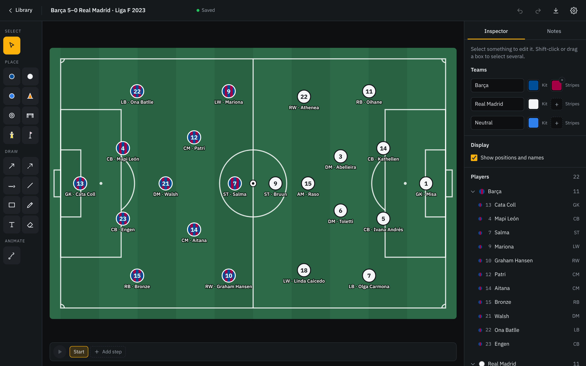
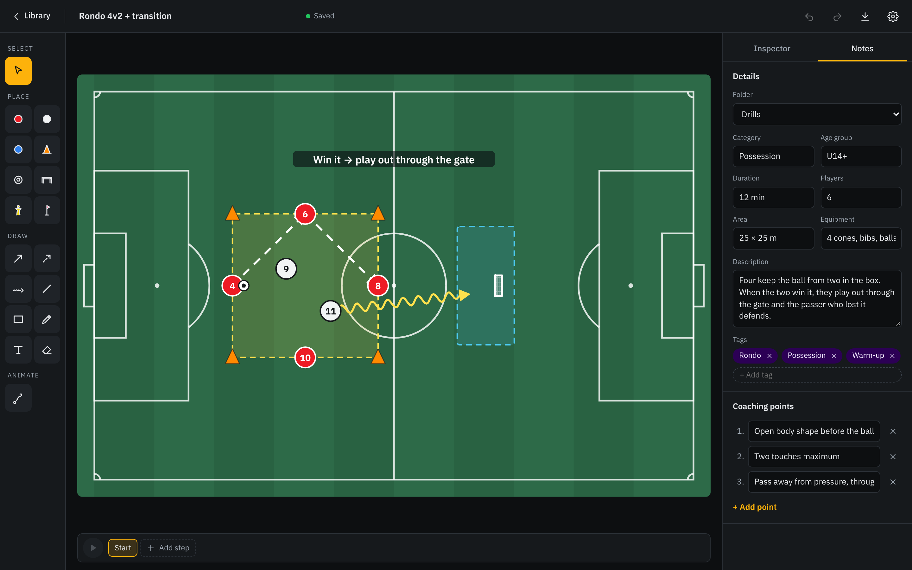
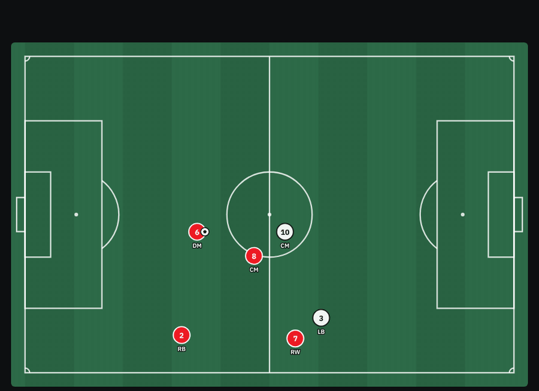
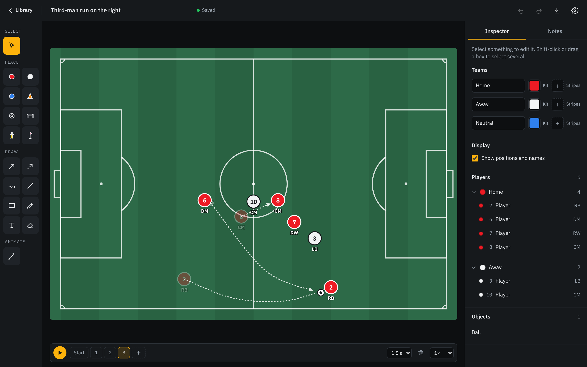
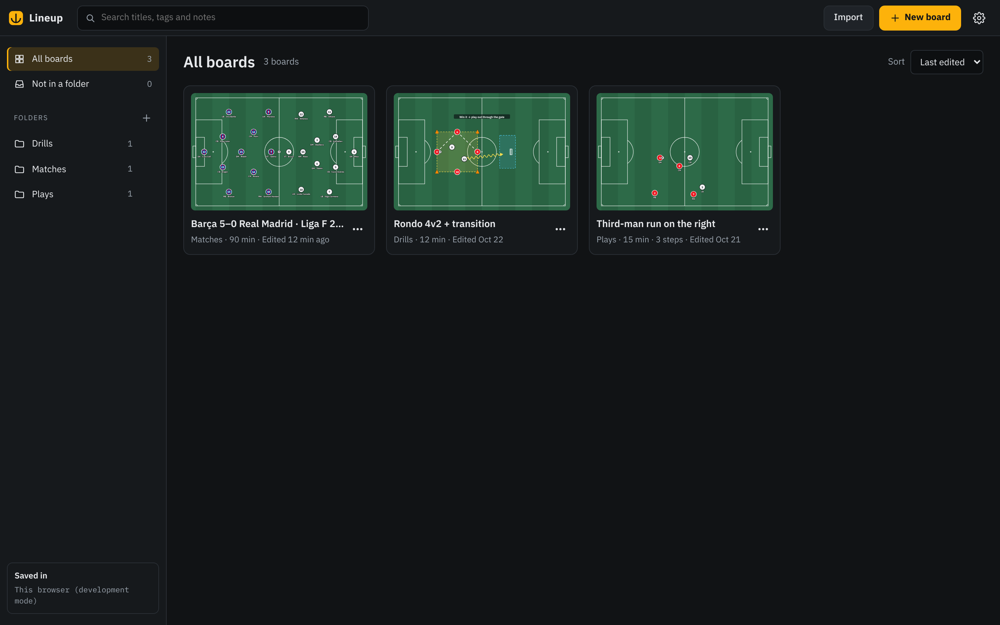

# Lineup

A tactical board for coaches: draw drills, set out line-ups, animate plays, and keep them all in one library on your computer.

> ⚠️ **Status: Alpha**
>
> Lineup is under active development. Features, the interface and the file format may still change.



## Overview

Lineup is a local-first desktop app for coaches. It brings four things together:

- **Library**: every drill, line-up and play you've saved, organised in folders
- **Editor**: players, equipment, arrows, zones and text on the pitch, with notes for the drill and step-by-step animation
- **Present / whiteboard** _(coming)_: show a drill or play full screen and draw over it live
- **Planner** _(coming)_: plan sessions and a season, and keep a log of the drills you ran with your team

Everything is stored as files on your computer. Windows comes first, then macOS and Linux, then tablets.

## Features

### Line-ups and players

- Home, away and neutral players with shirt numbers, positions and names
- Team kits in one colour or in stripes (like Barcelona's blue and garnet), and any player can have their own kit
- The sidebar groups players by team: fold a team away, or click its name to select the whole team
- Goalkeepers, cones, a ball, goals, mannequins and poles; goals and mannequins turn to any angle

### Drawing



- Run, pass and dribble arrows, lines, zones, freehand pen and highlighter, and text
- Bend arrows, resize zones, snap angles with Shift, and attach arrows to players
- Drill notes: category, age group, duration, players, area, equipment, description, coaching points and tags

### Animation



- Build a play in steps: each step moves some markers on from where the last one left them
- Drag markers to move them, or use the **Route** tool to click the points a player runs through; Lineup draws a smooth curve through them
- See each run as a dotted path with a faded marker where it started, and reshape it by dragging its waypoints
- Play, pause and step through (Space, `,` and `.`), set how long each step takes, and play at half or double speed



### Library and files



- Every board saves automatically to `Documents\Lineup` as a `.lineup` file
- Folders, search across titles, tags and notes, sorting, duplicating and deleting
- Import and export `.lineup` files, and export any board as a PNG image
- Undo and redo for every change
- Dark and light themes, five presets, and your own primary and secondary colours
- Keyboard shortcuts for everything (listed in Settings)

### Example boards

The [`examples`](examples) folder has boards you can import from the library's **Import** button:

- [`barca-real-madrid-2023.lineup`](examples/barca-real-madrid-2023.lineup): Barça 5–0 Real Madrid, Liga F, 19 November 2023, with both starting XIs
- [`rondo-4v2.lineup`](examples/rondo-4v2.lineup): a rondo with a transition gate
- [`third-man-run.lineup`](examples/third-man-run.lineup): an animated third-man run down the right

## Roadmap

| Version | Milestone | Status |
| --- | --- | --- |
| v0.3.0 | Board foundations: select, edit, delete, undo/redo, new editor layout, themes | ✅ |
| v0.4.0 | Drawing tools: arrows, lines, zones, pen, text, equipment | ✅ |
| v0.5.0 | Drills: library, saving and loading, notes, PNG export | ✅ |
| v0.6.0 | Animation: steps, routes and playback; striped kits | ✅ |
| v0.7.0 | Plays: present mode, video and GIF export | Next |
| v0.8.0 | Planner and session log | |
| v1.0.0 | Stable desktop release (Windows, macOS, Linux) | |

## Tech stack

- [Tauri 2](https://tauri.app) (Rust) for the desktop app and file access
- React 19 and TypeScript, built with Vite
- Vitest for tests

## Development

### Prerequisites

- [Node.js](https://nodejs.org) 20.19 or later
- [Rust](https://www.rust-lang.org/tools/install) and the [Tauri prerequisites](https://tauri.app/start/prerequisites/) for your platform

### Run locally

```bash
npm install
npm run tauri dev
```

`npm run dev` runs the app in a normal browser instead, with the library kept in the browser's storage. That's handy for working on the interface, but files and dialogs need the desktop app.

### Tests

```bash
npm test
```

## License

Copyright (C) 2025-2026 Aref "Daniel" Khojaste

Lineup is free software: you can redistribute it and/or modify it under the terms of the GNU Affero General Public License as published by the Free Software Foundation, either version 3 of the License, or (at your option) any later version. See [LICENSE](LICENSE) for the full text.

Lineup is distributed in the hope that it will be useful, but WITHOUT ANY WARRANTY; without even the implied warranty of MERCHANTABILITY or FITNESS FOR A PARTICULAR PURPOSE.

Releases up to and including v0.2.3 were published under the MIT License, and copies of those releases remain available under its terms.
